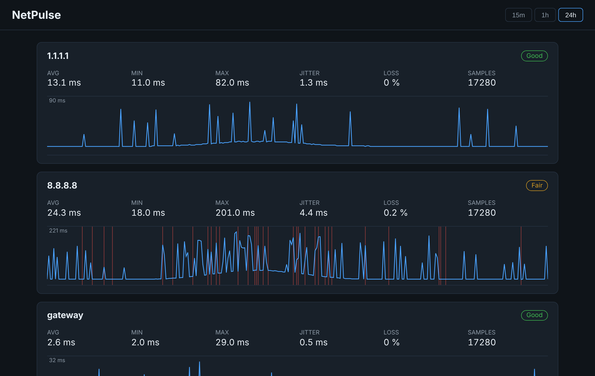

# NetPulse

[](https://github.com/Fpippi/NetPulse/actions/workflows/ci.yml)


**Is your connection really stable?** NetPulse is a free, open-source, self-hosted monitor that
continuously pings your router and the Internet, stores the results and shows latency, jitter and
packet loss on a live dashboard — so you can tell whether drops come from your Wi-Fi, your router
or your ISP.

<!-- TODO: add a screenshot or GIF of the dashboard -->
<!--  -->

## Features

- Continuous ping to the **default gateway** (auto-detected) and to public hosts (1.1.1.1, 8.8.8.8)
- **Latency, jitter, packet loss** and a simple quality rating (Good / Fair / Poor) per target
- Live **Blazor dashboard** with 15m / 1h / 24h views; spikes and losses stay visible on the chart
- **REST API** (`/api/samples`, `/api/stats`) for scripts and integrations
- Local **SQLite** storage with automatic retention — no cloud, no account, no tracking
- Runs on **Windows, Linux, macOS** and in **Docker** (Raspberry Pi included)

## Quick start

Requirements: [.NET 10 SDK](https://dotnet.microsoft.com/download)

```bash
git clone https://github.com/Fpippi/NetPulse.git
cd NetPulse
dotnet run --project src/NetPulse.Web
```

Open <http://localhost:5080>.

### Docker

```bash
docker build -t netpulse .
docker run -d --name netpulse -p 8080:8080 -v netpulse-data:/data netpulse
```

> On Linux, use `--network host` if you want the gateway seen by the container to be your real router.

## Configuration

Edit `src/NetPulse.Web/appsettings.json` or use environment variables (`NetPulse__IntervalSeconds=10`).

| Key               | Default                           | Description                                   |
|-------------------|-----------------------------------|-----------------------------------------------|
| `IntervalSeconds` | `5`                               | Time between ping rounds                      |
| `TimeoutMs`       | `1000`                            | Ping timeout                                  |
| `RetentionDays`   | `30`                              | Older samples are deleted automatically       |
| `DatabasePath`    | `data/netpulse.db`                | SQLite file                                   |
| `Targets`         | `gateway`, `1.1.1.1`, `8.8.8.8`   | Hosts to monitor (`gateway` = default router) |

## API

| Endpoint                                 | Description                       |
|------------------------------------------|-----------------------------------|
| `GET /api/samples?minutes=15&target=...` | Raw samples                       |
| `GET /api/stats?minutes=60`              | Aggregated stats per target       |

## Architecture

```
src/
  NetPulse.Core   Domain: models, ping probe, statistics, storage abstraction (no dependencies)
  NetPulse.Web    ASP.NET Core host: background monitor, SQLite store, REST API, Blazor dashboard
tests/
  NetPulse.Tests  NUnit tests for statistics and chart downsampling
```

## Roadmap

- [x] **v0.1** — Ping monitor, SQLite storage, dashboard, API
- [ ] **v0.2** — LAN device discovery (IP, MAC, vendor, hostname) and online/offline alerts
- [ ] **v0.3** — Scheduled speed tests, outage detection and timeline
- [ ] **v1.0** — Exportable reports (CSV/PDF) to send to your ISP

## Contributing

Issues and pull requests are welcome.

## License

[MIT](LICENSE)
