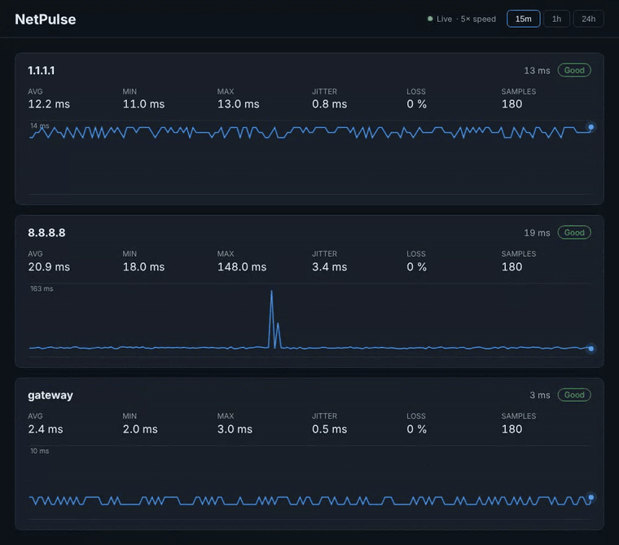

# NetPulse

[](https://github.com/Fpippi/NetPulse/actions/workflows/ci.yml)


**Is your connection really stable?** NetPulse is a free, open-source, self-hosted monitor that
continuously pings your router and the Internet, stores the results and shows latency, jitter and
packet loss on a live dashboard — so you can tell whether drops come from your Wi-Fi, your router
or your ISP.

<p align="center">
  <a href="https://fpippi.github.io/NetPulse/demo.html">
    
  </a>
</p>

<p align="center">
  <b><a href="https://fpippi.github.io/NetPulse/">Project page</a></b> ·
  <b><a href="https://fpippi.github.io/NetPulse/demo.html">Live demo</a></b>
  (simulated data, runs in your browser)
</p>

## Contents

- [Features](#features)
- [Quick start](#quick-start)
- [Configuration](#configuration)
- [API](#api)
- [Architecture](#architecture)
- [Development](#development)
- [Roadmap](#roadmap)

## Features

- Continuous ping to the **default gateway** (auto-detected) and to public hosts (1.1.1.1, 8.8.8.8)
- **Latency, jitter, packet loss** and a simple quality rating (Good / Fair / Poor) per target
- Live **Blazor dashboard** with 15m / 1h / 24h views; spikes and lost packets stay visible on the chart
- **LAN device discovery**: finds every device on your network (IP, MAC, vendor, host name) and tells you
  when a new device joins or a known one goes offline
- **Cooperative load testing** (iperf-style): measure real throughput and UDP loss between two of your own
  machines — both ends opt in, with duration and bandwidth safety caps
- **REST API** (`/api/samples`, `/api/stats`, `/api/devices`, `/api/loadtest`) for scripts and integrations
- Local **SQLite** storage with automatic retention — no cloud, no account, no tracking
- Runs on **Windows, Linux, macOS** and in **Docker** (Raspberry Pi included)

## Quick start

Requirements: [.NET 10 SDK](https://dotnet.microsoft.com/download)

```bash
git clone https://github.com/Fpippi/NetPulse.git
cd NetPulse
dotnet run --project src/NetPulse.Web
```

Open <http://localhost:5080>. The first samples appear after a few seconds.

### Docker

```bash
docker build -t netpulse .
docker run -d --name netpulse -p 8080:8080 -v netpulse-data:/data netpulse
```

Open <http://localhost:8080>.

> On Linux, use `--network host` if you want the gateway seen by the container to be your real router.
> If pings always time out, the container may not be allowed to send ICMP: add `--cap-add NET_RAW`.
> LAN discovery needs `--network host` too: on the default bridge network the container only sees Docker's
> own virtual network.

## Configuration

Edit `src/NetPulse.Web/appsettings.json` or use environment variables, e.g. `NetPulse__IntervalSeconds=10`
or, for lists, `NetPulse__Targets__0=gateway` and `NetPulse__Targets__1=192.168.1.10`.

| Key               | Default                           | Description                                   |
|-------------------|-----------------------------------|-----------------------------------------------|
| `IntervalSeconds` | `5`                               | Time between ping rounds                      |
| `TimeoutMs`       | `1000`                            | Ping timeout                                  |
| `RetentionDays`   | `30`                              | Older samples are deleted automatically       |
| `DatabasePath`    | `data/netpulse.db`                | SQLite file                                   |
| `Targets`         | `gateway`, `1.1.1.1`, `8.8.8.8`   | Hosts to monitor (`gateway` = default router) |
| `MaxCustomTargets`| `20`                              | How many extra hosts can be added from the dashboard |

### Custom targets

Besides the configured targets, you can add your own IP addresses or host names (e.g. your NAS,
a game server, a website) from the **Targets** card on the dashboard. They are saved in the SQLite
database, so they survive restarts. Click **×** on a custom target to stop monitoring it and delete
its history. Configured targets can only be changed in the configuration.

### LAN discovery

The **Devices** page lists every device found on your local network: IP address, MAC address, vendor
(looked up in a bundled copy of the IEEE OUI registry, no internet needed) and host name (reverse DNS).
Every 5 minutes NetPulse pings every address of the subnet, then reads the operating system's ARP table,
which also reveals devices whose firewall ignores pings. Click **Scan now** to scan immediately.

- A device that was never seen before is marked **new** and shows up under *Recent activity*.
- A device that misses `OfflineAfterMissedScans` scans in a row is reported **offline**, and **back online**
  when it answers again. Click **×** on an offline device to forget it.
- The first scan only builds the inventory, so you do not get an alert for every device you already own.
- Phones and laptops often use a random ("private") MAC address per network: they have no vendor, and if
  the address changes they appear as a new device.

Settings live in the `Discovery` section, e.g. `NetPulse__Discovery__IntervalSeconds=600`:

| Key                       | Default | Description                                              |
|---------------------------|---------|----------------------------------------------------------|
| `Enabled`                 | `true`  | Periodic scans (manual scans always work)                |
| `IntervalSeconds`         | `300`   | Time between scans (minimum 30)                          |
| `Subnet`                  | empty   | Subnet to scan, e.g. `192.168.1.0/24`; empty = auto-detect |
| `MaxPrefixLength`         | `24`    | An auto-detected subnet larger than this is reduced to the /24 around this machine |
| `PingTimeoutMs`           | `500`   | Ping timeout during the sweep                            |
| `MaxParallelism`          | `64`    | Pings and DNS lookups in flight at the same time         |
| `OfflineAfterMissedScans` | `2`     | Missed scans before a device is reported offline         |
| `EventRetentionDays`      | `90`    | Older device events are deleted automatically            |

The vendor list is `src/NetPulse.Core/Data/oui.txt`; refresh it with `python3 tools/update-oui.py`.

### Load testing

> ⚠️ **Only run a load test against devices you own or have explicit permission to test, on your own
> network.** This generates heavy traffic that can saturate a link. It is a diagnostic tool, not a
> stress weapon against someone else's machine.

The **Load test** page measures how much real throughput a link between two of your machines can carry,
in the spirit of `iperf`. It is **cooperative**: the target must be running NetPulse with the receiver
enabled, so both ends opt in before any traffic flows.

1. On the **target** machine (the one you want to stress), enable the receiver and restart NetPulse:
   set `NetPulse:LoadTest:ReceiverEnabled` to `true` (e.g. `NetPulse__LoadTest__ReceiverEnabled=true`).
   It then listens on the configured port for TCP and UDP.
2. On the **sender** machine, open **Load test**, enter the target's host/IP, pick TCP or UDP, a
   duration, an optional bandwidth cap and a number of parallel streams, then **Start test**.
3. Watch throughput live. TCP reports achievable goodput; UDP also reports packet loss (the receiver
   sends back how much it actually got). The target's own Load test page shows the incoming session.

Safety caps are enforced on every run: at most `300 s`, `1000 Mbps` and `32` parallel streams; values
above the limits are clamped. A bandwidth of `0` means "as fast as possible" (still bounded by the cap).

Settings live in the `LoadTest` section:

| Key               | Default | Description                                                          |
|-------------------|---------|----------------------------------------------------------------------|
| `ReceiverEnabled` | `false` | When `true`, this host accepts load tests (the opt-in target/agent)  |
| `Port`            | `5201`  | TCP + UDP port the receiver listens on                               |

> In Docker, publish the port (e.g. `-p 5201:5201/tcp -p 5201:5201/udp`) or use `--network host` on the
> target so the sender can reach the receiver.

## API

| Endpoint                                 | Description                       |
|------------------------------------------|-----------------------------------|
| `GET /api/samples?minutes=15&target=...` | Raw samples, optionally for one target |
| `GET /api/stats?minutes=60`              | Aggregated stats and quality per target |
| `GET /api/targets`                       | Monitored targets (`isCustom` marks the removable ones) |
| `POST /api/targets` `{"target":"example.com"}` | Add a custom target |
| `DELETE /api/targets/{target}`           | Remove a custom target and its samples |
| `GET /api/devices`                       | Scan status and all known LAN devices |
| `GET /api/devices/events?limit=50`       | Latest device events (`New`, `Offline`, `Online`) |
| `POST /api/devices/scan`                 | Scan the network now and return the new status |
| `DELETE /api/devices/{key}`              | Forget a device (key = MAC address, or `ip:<address>`) |
| `GET /api/loadtest`                      | Sender run state and receiver status |
| `POST /api/loadtest/start` `{"protocol":"Tcp","host":"...","port":5201,"durationSeconds":10,"targetMbps":0,"parallelStreams":4}` | Start a load test |
| `POST /api/loadtest/stop`                | Stop the current load test |

`minutes` defaults to 15 and is clamped between 1 minute and 7 days.

## Architecture

```
src/
  NetPulse.Core   Domain: models, ping probe, statistics, LAN discovery, load-test logic, storage abstraction (no dependencies)
  NetPulse.Web    ASP.NET Core host: background monitor, scanner and load-test receiver, SQLite store, REST API, Blazor dashboard
tests/
  NetPulse.Tests  NUnit tests for the Core logic
tools/            Maintenance scripts (vendor database update)
docs/             Project page and interactive demo (GitHub Pages)
```

## Development

```bash
dotnet build      # build everything
dotnet test       # run the NUnit tests
```

CI builds and tests every pull request and every push to `main` and `develop`, on Linux and Windows.

## Roadmap

- [x] **v0.1** — Ping monitor, SQLite storage, dashboard, API
- [x] **v0.2** — LAN device discovery (IP, MAC, vendor, hostname) and online/offline alerts
- [ ] **v0.3** — Scheduled speed tests, outage detection and timeline
- [ ] **v1.0** — Exportable reports (CSV/PDF) to send to your ISP

## Project page

The [project page](https://fpippi.github.io/NetPulse/) and the interactive demo live in [`docs/`](docs):
plain HTML, CSS and a small script that simulates samples in the browser with the same statistics as
`NetPulse.Core`. The `Pages` workflow publishes them to GitHub Pages on every push to `main` that touches
`docs/`.

## Contributing

Issues and pull requests are welcome.

## License

[MIT](LICENSE)
