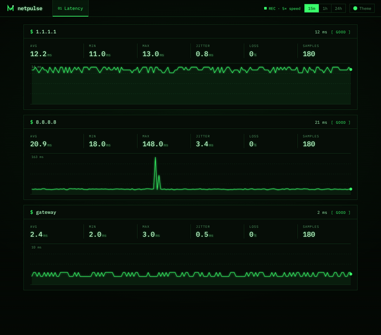

# NetPulse

[](https://github.com/Fpippi/NetPulse/actions/workflows/ci.yml)


**Is your connection really stable?** NetPulse is a free, open-source, self-hosted monitor that
continuously pings your router and the Internet, stores the results and shows latency, jitter and
packet loss on a live dashboard — so you can tell whether drops come from your Wi-Fi, your router
or your ISP.

<p align="center">
  <a href="https://fpippi.github.io/NetPulse/demo.html">
    
  </a>
</p>

<p align="center">
  <b><a href="https://fpippi.github.io/NetPulse/">Project page</a></b> ·
  <b><a href="https://fpippi.github.io/NetPulse/demo.html">Live demo</a></b>
  (simulated data, runs in your browser)
</p>

## Contents

- [Features](#features)
- [Quick start](#quick-start)
- [Configuration](#configuration)
- [API](#api)
- [Architecture](#architecture)
- [Development](#development)
- [Roadmap](#roadmap)

## Features

- Continuous ping to the **default gateway** (auto-detected) and to public hosts (1.1.1.1, 8.8.8.8)
- **DNS and HTTP probes** next to ping: resolver response time (`dns:example.com`) and time to a website's
  first response (`https://example.com`), because "the Internet is slow" is often a slow DNS server
- **Latency, jitter, packet loss** and a simple quality rating (Good / Fair / Poor) per target
- Live **Blazor dashboard** with 15m / 1h / 24h views; spikes and lost packets stay visible on the chart
- **Eleven themes**: Dark, Light, Cyberpunk, Anime (shōnen), Sakura, Bizarre with four colour variants (Night, Pastel, Desert, Ink) and Medieval, picked from the top bar and remembered by the
  browser (no JavaScript, fonts bundled, no CDN)
- **IPv6 next to IPv4**: the IPv6 router and public IPv6 hosts are monitored automatically on dual-stack
  networks, and outages are classified per IP version
- **Wi-Fi or cable**: shows how the machine reaches the router (Wi-Fi network and signal, or wired) and, for
  every outage, the link it happened on, to tell Wi-Fi problems apart from router and ISP problems
- **Check from your phone**: scan a QR code on the dashboard and test the phone's own connection (latency,
  loss and speed to NetPulse, then the router and the Internet); it says whether the problem is the Wi-Fi,
  the router, the provider or the phone itself
- **Outage detection**: N lost pings in a row become an outage, shown on a per-target timeline with
  downtime and availability — so you can tell a router problem (the gateway goes down too) from an ISP one
- **Backup and restore**: download the whole database in one click and restore it on another machine,
  without stopping monitoring
- **Scheduled speed tests**: download, upload and latency against a free public endpoint, with history
- **Traceroute on outages**: when a public target goes down, the route is recorded so the report shows where
  the path broke (your router, the ISP's first hop, or beyond)
- **Bufferbloat grade** (A+ to F): ping idle vs. during the download and upload, the hidden reason calls and
  games lag on a "fast" connection
- **ISP report**: a printable report (save it as PDF from the browser) with Internet outages, downtime,
  availability and speed against your contract, plus **CSV and JSON export** of all raw data
- **LAN device discovery**: finds every device on your network (IP, MAC, vendor, host name) and tells you
  when a new device joins or a known one goes offline; **watch** a device (your phone) to ping it every
  10 seconds and log every time it drops off the Wi-Fi, and at what time of day
- **Cooperative throughput testing** (iperf-style): measure real throughput and UDP loss between two of your
  own machines — both ends opt in, with duration and bandwidth safety caps
- **Notifications** on your phone or inbox (ntfy, Telegram, any webhook incl. Slack/Discord, e-mail) when a
  target goes down or comes back, a new device joins the network, or a speed test is slow — delivered even
  after an Internet outage, because undelivered alerts are retried
- **Prometheus `/metrics` and `/healthz`** for Grafana, Home Assistant, Uptime Kuma and Docker health checks
- **REST API** (`/api/samples`, `/api/stats`, `/api/outages`, `/api/speedtests`, `/api/report`, `/api/export`,
  `/api/devices`, `/api/loadtest`) for scripts and integrations
- Optional **password** for the dashboard and API (hashed with PBKDF2, brute-force throttling, API token for scripts)
- Local **SQLite** storage with a retention period per kind of data (or keep forever) and automatic compaction — no cloud, no account, no tracking
- Runs on **Windows, Linux, macOS** and in **Docker** (Raspberry Pi included)

## Quick start

### Download

Every [release](https://github.com/Fpippi/NetPulse/releases) has self-contained archives for
**Windows x64**, **Linux x64** and **Linux arm64** (Raspberry Pi 3/4/5 with a 64-bit OS): nothing else to
install. Extract the archive, then from inside the `netpulse` folder run:

```bash
./NetPulse.Web --urls http://0.0.0.0:5080      # Linux
NetPulse.Web.exe --urls http://0.0.0.0:5080    # Windows
```

Open <http://localhost:5080>. Run it from its own folder: settings are read from `appsettings.json` and
the database is created in `data/` under the current directory. `SHA256SUMS.txt` lists the checksums.

### From source

Requirements: [.NET 10 SDK](https://dotnet.microsoft.com/download)

```bash
git clone https://github.com/Fpippi/NetPulse.git
cd NetPulse
dotnet run --project src/NetPulse.Web
```

Open <http://localhost:5080>. The first samples appear after a few seconds.

### Docker

```bash
docker build -t netpulse .
docker run -d --name netpulse -p 8080:8080 -v netpulse-data:/data netpulse
```

Open <http://localhost:8080>.

> On Linux, use `--network host` if you want the gateway seen by the container to be your real router.
> If pings always time out, the container may not be allowed to send ICMP: add `--cap-add NET_RAW`.
> LAN discovery needs `--network host` too: on the default bridge network the container only sees Docker's
> own virtual network.

## Configuration

Edit `src/NetPulse.Web/appsettings.json` or use environment variables, e.g. `NetPulse__IntervalSeconds=10`
or, for lists, `NetPulse__Targets__0=gateway` and `NetPulse__Targets__1=192.168.1.10`.

| Key               | Default                           | Description                                   |
|-------------------|-----------------------------------|-----------------------------------------------|
| `IntervalSeconds` | `5`                               | Time between ping rounds                      |
| `TimeoutMs`       | `1000`                            | Ping timeout                                  |
| `DnsTimeoutMs`    | `2000`                            | Timeout of DNS targets                        |
| `HttpTimeoutMs`   | `5000`                            | Timeout of HTTP targets                       |
| `RetentionDays`   | `30`                              | Older samples are deleted automatically (0 = keep forever), see [Data retention](#data-retention) |
| `DatabasePath`    | `data/netpulse.db`                | SQLite file                                   |
| `Targets`         | `gateway`, `1.1.1.1`, `8.8.8.8`   | Targets to monitor (`gateway` = default router), see below |
| `MaxCustomTargets`| `20`                              | How many extra targets can be added from the dashboard |
| `Ipv6`            | `Auto`                            | Also monitor IPv6, see below (`Auto`, `On`, `Off`) |

### Password protection

Out of the box anyone who can reach the dashboard can use it, including adding and removing targets and
starting tests. On a shared network, set a password: every page and API call then needs a signed-in
session (or the API token), and a **Sign out** button appears in the top bar. Only the sign-in page,
static files and `/healthz` stay open.

Create a hash, so the configuration never holds the password itself:

```bash
./NetPulse.Web hash-password                                  # release archive: asks twice, prints the hash
dotnet run --project src/NetPulse.Web -- hash-password        # from source
docker run --rm -it netpulse hash-password                    # Docker
```

| Key (`NetPulse:Auth`) | Default | Description |
|-----------------------|---------|-------------|
| `Password`            | empty   | The `pbkdf2-sha256$…` hash printed above (a plain password works too, but is stored in clear). Empty = no sign-in |
| `ApiToken`            | empty   | Optional long random token for scripts, Prometheus and Home Assistant: `Authorization: Bearer <token>` on `/api/*` and `/metrics` |
| `SessionDays`         | `30`    | A session lasts this long since the last visit |

For example `NetPulse__Auth__Password='pbkdf2-sha256$600000$…'` (single quotes keep the `$` signs). After
five wrong passwords from the same address, sign-in is refused for 15 minutes. NetPulse speaks plain HTTP:
outside your home network, put it behind a reverse proxy with HTTPS (Caddy, Traefik, nginx).

### Data retention

Every kind of history has its own retention period, so the database stays small while the outage history
can still back a report to your ISP months later:

| History                        | Setting                              | Default |
|--------------------------------|--------------------------------------|---------|
| Ping, DNS and HTTP samples, Wi-Fi/wired history | `NetPulse:RetentionDays` | 30 days |
| Outages and their traceroutes  | `NetPulse:Outages:RetentionDays`     | 1 year  |
| Speed tests                    | `NetPulse:SpeedTest:RetentionDays`   | 1 year  |
| LAN device events              | `NetPulse:Discovery:EventRetentionDays` | 90 days |

`0` keeps that history forever. Old data is deleted a minute after startup and then every hour, whether or
not the feature that produced it is still enabled. After a large clean-up (e.g. when you shorten a period)
the SQLite file is compacted once, so the space goes back to the disk. The **Stored data** card at the
bottom of the Report page, and `GET /api/retention`, show the periods, what the last clean-up deleted and
the database size.

### Backup and restore

The **Backup** card at the bottom of the Report page downloads the whole database (every sample, outage,
speed test, device and setting stored by NetPulse) as one SQLite file, e.g.
`netpulse-backup-2026-11-19-1530.db`. The copy is consistent (`VACUUM INTO` reads one snapshot) and is taken
while monitoring keeps running.

**Restore** a backup from the same card, for example to move NetPulse from a PC to a Raspberry Pi: pick the
file, confirm, and every table is replaced in place, without a restart. Before that NetPulse:

- refuses anything that is not an intact NetPulse database (SQLite header, `quick_check`, required tables);
- saves the current data as `netpulse.before-restore.db` next to the database, so a wrong file can be undone
  by restoring that one;
- adds the tables and columns a backup from an older version lacks, as after an upgrade.

From a script:

```bash
curl -o netpulse.db http://localhost:5080/api/backup
curl --data-binary @netpulse.db http://localhost:5080/api/backup/restore
```

(add `-H "Authorization: Bearer <ApiToken>"` when the dashboard has a password). Files up to 4 GB are accepted.

### Target types

| Target                     | Measures                                                                     |
|----------------------------|------------------------------------------------------------------------------|
| `1.1.1.1`, `my-nas`        | **Ping** (ICMP echo) round-trip time                                         |
| `2606:4700:4700::1111`, `gateway6` | **Ping over IPv6**: an IPv6 address, or the IPv6 default router      |
| `ping6:example.com`, `ping4:example.com` | **Ping** a host name over IPv6 (or IPv4) only, whatever the system would prefer |
| `dns:example.com`          | **DNS**: time for the system's DNS server (usually your router) to answer an A query for the name |
| `dns:example.com@1.1.1.1`  | **DNS** against a specific server, e.g. to compare your ISP's resolver with a public one |
| `https://example.com/`     | **HTTP**: a GET on a fresh connection until the response headers arrive (DNS + TCP + TLS + server time), like a browser's first visit; any status below 500 counts as up |

All types share the same charts, statistics, outage detection and reports. The quality rating uses a scale
that fits each type (an HTTPS request at 200 ms is fine, a ping at 200 ms is not). DNS queries go straight
to the server, so the operating system's cache does not hide a slow resolver; on Linux with systemd-resolved
the "system" server can be the local stub (`127.0.0.53`), so name a server explicitly to bypass it.
On a network with IPv6, the dashboard tags every card with its IP version.
HTTP targets are requested every `IntervalSeconds`: point them at sites you own or that expect monitoring
traffic, or raise the interval.

### IPv6

Many connections are dual-stack, and IPv6 can break on its own: the router loses its prefix, the ISP's
IPv6 path is down while IPv4 works, or the other way round. With `Ipv6` on `Auto` (the default), when this
machine has a global IPv6 address at startup NetPulse adds three targets next to yours: `gateway6` (the
IPv6 router), `2606:4700:4700::1111` (Cloudflare) and `2001:4860:4860::8888` (Google). `On` always adds
them, `Off` never does, and nothing is added if your `Targets` already contain an IPv6 target.

Outages are classified per IP version: when both IPv6 hosts are down while the IPv4 ones answer, the
outage is reported as an Internet outage of the IPv6 path, not as two single-host problems.

> Docker's default bridge network has no IPv6: use `--network host` (Linux) to monitor it.

### Custom targets

Besides the configured targets, you can add your own targets of any type (e.g. your NAS,
a game server, `dns:example.com@8.8.8.8`, `https://your-site.example/`) from the **Targets** card on the dashboard. They are saved in the SQLite
database, so they survive restarts. Click **×** on a custom target to stop monitoring it and delete
its history. Configured targets can only be changed in the configuration.

### Wi-Fi or cable

When the connection drops, the first question is whether it was the Wi-Fi of the machine running
NetPulse, the router or the ISP. NetPulse checks every 30 seconds which interface carries the default route
and shows it in a **Connection** card on the latency page: Wi-Fi (network name, signal in dBm rated
good / fair / poor, link rate) or wired (link speed). One reading a minute is stored, so the Outages page
and the ISP report show, for each outage, how the machine was connected when it started:

- an outage of the router (*local network*) **on Wi-Fi**, especially with a weak signal, is most likely the
  Wi-Fi rather than the router or the ISP;
- an **Internet** outage happened while the router answered, so the local link was fine either way;
- on a **wired** machine, Wi-Fi problems are ruled out.

| Platform | Link type | Wi-Fi network and signal |
|----------|-----------|--------------------------|
| Linux    | `/sys/class/net` | `iw` if installed (network, signal, rate), else `/proc/net/wireless` (signal only) |
| Windows  | .NET interface type | `netsh wlan show interfaces` (any display language) |
| macOS    | .NET interface type, often reported as Ethernet | not read |

In Docker on the default bridge network the container only sees a virtual interface, so the link type is
*Unknown*: use `--network host` (Linux). History of the link follows `RetentionDays` of the samples.
`GET /api/link?hours=24` returns the current link and its recent history.

### Check from your phone

NetPulse measures the connection of the machine it runs on. When it is the phone that says "connected,
no Internet", open the **Check** page on the computer and scan the QR code with the phone (the code is
generated locally and points to the computer's LAN address, e.g. `http://192.168.1.10:5080/check`).
On the phone, **Start the check** measures, in about 15 seconds:

1. 30 round trips to NetPulse (median, jitter, loss): one hop over the Wi-Fi, so anything slow or lost
   here is the Wi-Fi itself;
2. download and upload speed between the phone and NetPulse;
3. whether the phone reaches the router (it loads the router's address; browsers cannot ping);
4. whether the phone reaches the Internet (it loads `InternetCheckUrl`, nothing is read from it).

NetPulse adds what it knows itself (whether *it* is online right now) and answers with one verdict:
bad or weak Wi-Fi, the phone dropped off, the phone cannot reach the router, the Internet is down for
everyone, only the phone has no Internet, or all good, with what to try next. The computer's Check page
lists the latest checks of every device live (kept in memory until NetPulse restarts).

If the page does not open on the phone at all, the phone cannot reach the computer: that already says the
problem is the Wi-Fi or the router. NetPulse must listen on the network (`--urls http://0.0.0.0:5080`, the
default in Docker); when it only listens on `localhost` the page says so instead of showing a code.
In Docker on the default bridge network the container only knows its own internal address, so use
`--network host` (Linux) or set `ClientCheck:Url` to the host's address.
With a password, the phone signs in once and goes straight back to the check.

```json
"ClientCheck": {
  "Url": "",                                            // address for phones, e.g. behind a reverse proxy
  "InternetCheckUrl": "https://cloudflare.com/cdn-cgi/trace", // empty skips the step
  "CheckRouter": true
}
```

The check page is the only one with a script (`wwwroot/check.js`, no libraries): the measurements have to
run in the phone's browser.

### Outages

NetPulse counts an **outage** when a target misses `ConsecutiveLosses` pings in a row (3 by default, about
15 seconds at the default interval); shorter runs are ordinary packet loss. The outage starts at the first
lost ping and ends at the next reply. The **Outages** page shows them on a timeline with one row per
target (24h, 7d or 30d), the downtime, longest outage and availability of each target, and the full history.
An outage in progress is highlighted at the top of the page.

Comparing rows tells you where the problem is: if `gateway` is down too, the problem is your Wi-Fi or
router; if only the public hosts are down, it is your ISP. Outages are kept for a year by default (longer
than raw samples), so the history is there when you need to complain. If NetPulse stops during an outage,
the outage is closed at its last lost ping on the next start, since nobody watched in between.

When an outage of a public target starts, NetPulse also runs a **traceroute** towards it and stores the
route with the outage: who answered at hop 1 (your router), hop 2 (usually the first router of your ISP) and
so on. The **Route** column on the Outages page and the ISP report then say *where* the path was cut, e.g.
"Stopped after hop 2 (100.64.0.1); nothing answered beyond it", which is far more convincing for your ISP
than "the Internet did not work". Traces run one at a time in the background and stop after 4 silent hops.

Settings live in the `Outages` section, e.g. `NetPulse__Outages__ConsecutiveLosses=5`:

| Key                 | Default | Description                                         |
|---------------------|---------|-----------------------------------------------------|
| `ConsecutiveLosses` | `3`     | Lost pings in a row that make an outage             |
| `RetentionDays`     | `365`   | Older outages are deleted automatically (0 = forever) |
| `TraceRoute`        | `true`  | Traceroute towards a public target when its outage starts |
| `TraceMaxHops`      | `20`    | Farthest hop the traceroute probes                  |

> Traceroute needs ICMP with a custom TTL. On Linux, if every trace shows no hop at all, give the process
> raw-socket permission (`--cap-add NET_RAW` in Docker, or `setcap cap_net_raw+ep` on the binary).

### Speed tests

The **Speed** page shows the latest download, upload and latency, plus the history of all tests (7d or
30d) with averages and minimums. Tests run every 6 hours and on demand with **Run now**; only one test runs
at a time. By default they use Cloudflare's free speed-test endpoint (`speed.cloudflare.com`), over plain
HTTPS: latency is the median of a few empty requests, and the first 20% of each transfer is ignored as TCP
warm-up.

#### Bufferbloat

During each test NetPulse also pings `BufferbloatHost` (1.1.1.1 by default): ten times on the idle line,
then every 200 ms during the download and during the upload. The grade comes from the extra latency in the
worse direction (median under load minus median idle): **A+** below 5 ms, **A** below 30, **B** below 60,
**C** below 200, **D** below 400, **F** above. A or A+ means video calls and games stay smooth while someone
downloads; C or worse usually improves a lot with SQM / Smart Queue (fq_codel, CAKE) on the router.
The idle and loaded pings are stored with each test and exported in the speed-test CSV.

> Each test transfers about **35 MB** (25 MB down, 10 MB up), so the default schedule uses about 140 MB a
> day. On a metered connection, lower the sizes, raise the interval or set `Enabled` to `false`.

Settings live in the `SpeedTest` section, e.g. `NetPulse__SpeedTest__IntervalMinutes=720`:

| Key               | Default                                            | Description                               |
|-------------------|----------------------------------------------------|-------------------------------------------|
| `Enabled`         | `true`                                             | Scheduled tests ("Run now" always works)  |
| `IntervalMinutes` | `360`                                              | Time between scheduled tests (minimum 15) |
| `DownloadBytes`   | `25000000`                                         | Download size (`0` skips the download)    |
| `UploadBytes`     | `10000000`                                         | Upload size (`0` skips the upload)        |
| `DownloadUrl`     | `https://speed.cloudflare.com/__down?bytes={bytes}` | Download endpoint; `{bytes}` is replaced with the size |
| `UploadUrl`       | `https://speed.cloudflare.com/__up`                | Endpoint that accepts the upload as a POST body |
| `BufferbloatHost` | `1.1.1.1`                                          | Host pinged idle and under load; empty turns bufferbloat off |
| `TimeoutSeconds`  | `120`                                              | A slower test is recorded as failed       |
| `RetentionDays`   | `365`                                              | Older results are deleted automatically (0 = forever) |

### Reports for your ISP

The **Report** page summarizes a period (the last 30 days by default) in a form you can send to your
provider. Pick the dates and, optionally, the download and upload speeds in your contract, then click
**Print / Save as PDF**: the print stylesheet hides the dashboard and prints only the report.

- **Summary**: number of Internet outages, total Internet downtime, average download and upload speed
  (and the share of the contracted speed).
- **Latency, loss and availability** for every target: pings, average and maximum latency, jitter, packet
  loss, outages, downtime and availability.
- **Outages** with their **likely cause**, judged by what else was down at the same time:
  *Local network* (the router did not answer either), *Internet (ISP)* (the router answered but every
  public host was down), *Single host* (only that host was down) or *Unknown* (the gateway is not
  monitored). Only Internet outages count toward the Internet downtime, and overlapping outages of
  different hosts count once.
- **Speed tests**, with how many measured less than half the contracted speed.
- **How this was measured**: interval, timeout, outage threshold and speed test method.

The page also links the raw data of the same period as **CSV** and **JSON**: ping samples, outages (with
cause) and speed tests. CSV files use commas, a `.` decimal separator and UTC timestamps in ISO 8601, so
they import the same way everywhere (in Excel with an Italian locale, use *Data → From Text/CSV*). JSON
files are an array of flat objects with the same fields as the CSV columns, with real numbers, booleans
and `null` for missing values, ready for scripts:

```bash
curl -s "http://localhost:5080/api/export/samples.json?days=7&target=1.1.1.1" | jq '[.[] | select(.success | not)] | length'
python -c "import pandas as pd; print(pd.read_json('netpulse-samples-2026-11-10_2026-11-17.json').describe())"
```

### LAN discovery

The **Devices** page lists every device found on your local network: IP address, MAC address, vendor
(looked up in a bundled copy of the IEEE OUI registry, no internet needed) and host name.
Every 5 minutes NetPulse pings every address of the subnet, then reads the operating system's ARP table,
which also reveals devices whose firewall ignores pings. Click **Scan now** to scan immediately.

Host names come from three sources, so fewer devices stay unnamed: reverse **DNS**, **NetBIOS** (UDP 137,
Windows and Samba) and **mDNS/Bonjour** (UDP 5353, Apple, Avahi and many IoT devices). You can also give
any device your own **name**: hover a row and click the pencil, type a label and save. Your label is kept
across scans and shown instead of the detected name (which stays visible underneath).

- A device that was never seen before is marked **new** and shows up under *Recent activity*.
- A device that misses `OfflineAfterMissedScans` scans in a row is reported **offline**, and **back online**
  when it answers again. Click **×** on an offline device to forget it.
- The first scan only builds the inventory, so you do not get an alert for every device you already own.
- Phones and laptops often use a random ("private") MAC address per network: they have no vendor, and if
  the address changes they appear as a new device.

Settings live in the `Discovery` section, e.g. `NetPulse__Discovery__IntervalSeconds=600`:

| Key                       | Default | Description                                              |
|---------------------------|---------|----------------------------------------------------------|
| `Enabled`                 | `true`  | Periodic scans (manual scans always work)                |
| `IntervalSeconds`         | `300`   | Time between scans (minimum 30)                          |
| `Subnet`                  | empty   | Subnet to scan, e.g. `192.168.1.0/24`; empty = auto-detect |
| `MaxPrefixLength`         | `24`    | An auto-detected subnet larger than this is reduced to the /24 around this machine |
| `PingTimeoutMs`           | `500`   | Ping timeout during the sweep                            |
| `MaxParallelism`          | `64`    | Pings and DNS lookups in flight at the same time         |
| `OfflineAfterMissedScans` | `2`     | Missed scans before a device is reported offline         |
| `EventRetentionDays`      | `90`    | Older device events are deleted automatically (0 = forever) |

The vendor list is `src/NetPulse.Core/Data/oui.txt`; refresh it with `python3 tools/update-oui.py`.

#### Watching a device

A scan every 5 minutes cannot tell when a phone drops off the Wi-Fi for a minute. Click the **eye** next to
a device to watch it: NetPulse pings it every 10 seconds, and 3 missed pings in a row count as a
**drop-off** that lasts until the next reply. The *Watched devices* card shows each drop on a timeline
(1, 7 or 30 days) and in a list with start, end and duration, and points out when most drops start in the
same two hours of the day (something on a schedule: a microwave, a neighbour's network, a power-saving
setting). With notifications set up you get an alert when a watched device drops off and when it is back
(`Notifications:Events:WatchedDevices`, on by default).

Devices are followed by MAC address, so the address of the latest scan is pinged. Phones in deep sleep may
skip a few pings: raise `WatchMissesToDrop` if a phone in a drawer shows short drops. A phone with a
random MAC that changes per network appears as a new device and must be watched again.

| Key                    | Default | Description                                         |
|------------------------|---------|-----------------------------------------------------|
| `WatchIntervalSeconds` | `10`    | Time between two pings of each watched device       |
| `WatchMissesToDrop`    | `3`     | Missed pings in a row before it counts as a drop-off |
| `WatchTimeoutMs`       | `1000`  | Ping timeout                                        |

Drop-offs follow `EventRetentionDays`.

### Throughput testing

> ⚠️ **Only run a throughput test against devices you own or have explicit permission to test, on your
> own network.** It sends real traffic that can saturate a link. It is a diagnostic tool, not a stress
> weapon against someone else's machine.

The **Throughput** page measures how much real throughput a link between two of your machines can carry,
in the spirit of `iperf`. It is **cooperative**: the target must be running NetPulse with the receiver
enabled, so both ends opt in before any traffic flows.

1. On the **target** machine, enable the receiver and restart NetPulse:
   set `NetPulse:LoadTest:ReceiverEnabled` to `true` (e.g. `NetPulse__LoadTest__ReceiverEnabled=true`).
   It then listens on the configured port for TCP and UDP.
2. On the **sender** machine, open **Throughput**, enter the target's host/IP, pick TCP or UDP, a
   duration, an optional bandwidth cap and a number of parallel streams, then **Start test**.
3. Watch throughput live. TCP reports achievable goodput; UDP also reports packet loss (the receiver
   sends back how much it actually got). The target's own Throughput page shows the incoming session.

Safety caps are enforced on every run: at most `300 s`, `1000 Mbps` and `32` parallel streams; values
above the limits are clamped. A bandwidth of `0` means "as fast as possible" (still bounded by the cap).

Settings live in the `LoadTest` section:

| Key               | Default | Description                                                          |
|-------------------|---------|----------------------------------------------------------------------|
| `ReceiverEnabled` | `false` | When `true`, this host accepts load tests (the opt-in target/agent)  |
| `Port`            | `5201`  | TCP + UDP port the receiver listens on                               |

> In Docker, publish the port (e.g. `-p 5201:5201/tcp -p 5201:5201/udp`) or use `--network host` on the
> target so the sender can reach the receiver.

### Notifications

NetPulse can alert you when a target goes **down** and when it is **back** (after `ConsecutiveLosses`
lost pings, like the Outages page), when a **new device** joins your network, and when a **speed test**
fails or is slower than a minimum you set. All channels are free and off until configured; set as many
as you like in the `Notifications` section:

| Key                         | Description                                                                 |
|-----------------------------|-----------------------------------------------------------------------------|
| `NtfyUrl`, `NtfyToken`      | [ntfy](https://ntfy.sh) topic URL (e.g. `https://ntfy.sh/netpulse-k3x9q`; use a hard-to-guess topic or your own server) and an optional access token. Install the ntfy app and subscribe to the topic. |
| `TelegramBotToken`, `TelegramChatId` | Create a bot with @BotFather, send it a message, then read the chat id from `https://api.telegram.org/bot<token>/getUpdates`. |
| `WebhookUrl`                | Receives a JSON `POST` (`kind`, `severity`, `title`, `message`, `timestamp`); also carries `text` and `content`, so Slack and Discord incoming webhooks work directly. Handy for Home Assistant, n8n or Node-RED. |
| `Smtp:Host`, `Port` (587), `EnableSsl` (true), `User`, `Password`, `From`, `To` | E-mail through any SMTP server; `To` is comma-separated. With Gmail use an app password. |
| `Events:Outages` (true), `Events:NewDevices` (true), `Events:DeviceOffline` (false), `Events:WatchedDevices` (true), `Events:SpeedTests` (true) | Which events send an alert. Devices going offline is off by default: phones come and go all day; watched devices (eye button on the Devices page) alert by default. |
| `MinDownloadMbps`, `MinUploadMbps` | Alert when a speed test is below these (0 = only failed tests).         |
| `BatchSeconds` (10)         | Events closer together are merged into one alert (an ISP outage takes down every public target at once). |
| `RetryHours` (24)           | Alerts that cannot be delivered (the Internet is down, after all) are retried with backoff for this long. |

Example with environment variables: `NetPulse__Notifications__NtfyUrl=https://ntfy.sh/netpulse-k3x9q`.
Check the setup with `curl -X POST http://localhost:5080/api/notifications/test`, which sends a test alert
to every channel and reports the result of each. Keep tokens and passwords out of `appsettings.json` if you
commit it: use environment variables or [user secrets](https://learn.microsoft.com/aspnet/core/security/app-secrets).

### Health and metrics

- `GET /healthz` answers `200 Healthy` when the monitoring loop completed a cycle recently (within three
  intervals, at least 30 s) and the database is readable, otherwise `503 Unhealthy`. Point Uptime Kuma,
  a reverse proxy or an orchestrator at it to restart NetPulse if it hangs.
- `GET /metrics` exposes the current state in the Prometheus text format, so Grafana (via Prometheus) or
  Home Assistant's Prometheus integration can chart it next to everything else:

| Metric | Labels | Meaning |
|--------|--------|---------|
| `netpulse_target_up` | `target` | 1 while the target answers, 0 during an outage or before its first sample |
| `netpulse_latency_avg_ms`, `_min_ms`, `_max_ms` | `target` | Round-trip times over the last 5 minutes |
| `netpulse_jitter_ms`, `netpulse_packet_loss_ratio`, `netpulse_samples` | `target` | Jitter, loss (0–1) and probe count over the last 5 minutes |
| `netpulse_speedtest_download_mbps`, `_upload_mbps`, `_latency_ms`, `_success`, `_timestamp_seconds` | | Latest speed test |
| `netpulse_lan_devices_known`, `netpulse_lan_devices_online` | | LAN devices |
| `netpulse_outages_ongoing` | | Outages in progress |

A minimal Prometheus scrape config:

```yaml
scrape_configs:
  - job_name: netpulse
    scrape_interval: 30s
    static_configs:
      - targets: ["netpulse-host:5080"]
    # With a dashboard password, also: authorization: { credentials: "<ApiToken>" }
```

## API

| Endpoint                                 | Description                       |
|------------------------------------------|-----------------------------------|
| `GET /api/samples?minutes=15&target=...` | Raw samples, optionally for one target |
| `GET /api/stats?minutes=60`              | Aggregated stats and quality per target |
| `GET /api/outages?hours=24`              | Outages in the period, with a downtime/availability summary per target and the traceroute taken when each started |
| `GET /api/speedtests?days=7`             | Speed test results in the period, summary and scheduler status |
| `POST /api/speedtests/run`               | Run a speed test now and return its result (`409` if one is running) |
| `GET /api/report?days=30&download=100&upload=20` | The ISP report as JSON (`download`/`upload` = contracted Mbps, optional) |
| `GET /api/export/samples.csv?days=7&target=...` | Ping samples as CSV (`samples.json` for JSON) |
| `GET /api/export/outages.csv?days=30`    | Outages with their likely cause as CSV (`outages.json` for JSON) |
| `GET /api/export/speedtests.csv?days=30` | Speed test results as CSV (`speedtests.json` for JSON) |
| `GET /api/backup`                       | The whole database as a SQLite file (consistent copy) |
| `POST /api/backup/restore`               | Replace all data with the SQLite file in the request body; returns the samples restored and where the previous data was saved |
| `GET /api/retention`                     | Retention period per kind of data, last clean-up and database size |
| `GET /api/link?hours=24`                 | Current link (Wi-Fi/wired, network, signal, speed) and its history |
| `GET /api/notifications`                 | Configured notification channels |
| `POST /api/notifications/test`           | Send a test alert to every channel and report each result |
| `GET /api/targets`                       | Monitored targets (`isCustom` marks the removable ones) |
| `POST /api/targets` `{"target":"example.com"}` | Add a custom target |
| `DELETE /api/targets/{target}`           | Remove a custom target and its samples |
| `GET /api/devices`                       | Scan status and all known LAN devices |
| `GET /api/devices/events?limit=50`       | Latest device events (`New`, `Offline`, `Online`) |
| `POST /api/devices/scan`                 | Scan the network now and return the new status |
| `PUT /api/devices/{key}/label` `{"label":"NAS"}` | Set or clear a device's custom name |
| `GET /api/devices/watched?days=7`        | Watched devices with their drop-offs, whether they answer now and the time-of-day pattern |
| `PUT /api/devices/{key}/watch`           | Start watching a device (`DELETE` stops; the history is kept) |
| `DELETE /api/devices/{key}`              | Forget a device (key = MAC address, or `ip:<address>`) |
| `GET /api/check/ping`, `GET /api/check/download?bytes=N`, `POST /api/check/upload` | Used by the Check page to measure a device's link (download at most 64 MB, upload 16 MB) |
| `POST /api/check/result` `{"roundTripsMs":[3.1,null],"downloadMbps":90,"uploadMbps":40,"router":"Reachable","internet":"Unreachable"}` | Verdict for a device's measurements (`null` = lost request) |
| `GET /api/check/recent`                  | Latest checks from all devices |
| `GET /api/loadtest`                      | Sender run state and receiver status |
| `POST /api/loadtest/start` `{"protocol":"Tcp","host":"...","port":5201,"durationSeconds":10,"targetMbps":0,"parallelStreams":4}` | Start a load test |
| `POST /api/loadtest/stop`                | Stop the current load test |

When a password is set, API calls need the session cookie or `Authorization: Bearer <ApiToken>`;
without either they get `401`.

`minutes` defaults to 15 and is clamped between 1 minute and 7 days. Reports and exports take either
`days` (default 30, at most 366) or `from` and `to` as dates (`yyyy-MM-dd`, both inclusive, whole days in
the server's time zone).

## Architecture

```
src/
  NetPulse.Core   Domain: models, ping probe, statistics, outage detection, speed test, reports and CSV,
                  LAN discovery, load-test logic, storage abstraction (no dependencies)
  NetPulse.Web    ASP.NET Core host: background monitor, speed-test scheduler, scanner and load-test receiver,
                  SQLite store, REST API, Blazor dashboard
tests/
  NetPulse.Tests  NUnit tests for the Core logic
tools/            Maintenance scripts (vendor database update)
docs/             Project page and interactive demo (GitHub Pages)
```

## Development

```bash
dotnet build      # build everything
dotnet test       # run the NUnit tests
```

CI builds and tests every pull request and every push to `main` and `develop`, on Linux and Windows.

To publish a release, push a version tag: `git tag v1.0.0 && git push origin v1.0.0`. The `Release`
workflow tests the code, builds the self-contained archives for every platform and attaches them, with
their checksums, to a new GitHub release.

## Roadmap

- [x] **v0.1** — Ping monitor, SQLite storage, dashboard, API
- [x] **v0.2** — LAN device discovery (IP, MAC, vendor, hostname) and online/offline alerts
- [x] **v0.3** — Scheduled speed tests, outage detection and timeline
- [x] **v1.0** — Exportable reports (CSV/PDF) to send to your ISP, release binaries

## Project page

The [project page](https://fpippi.github.io/NetPulse/) and the interactive demo live in [`docs/`](docs):
plain HTML, CSS and a small script that simulates samples in the browser with the same statistics as
`NetPulse.Core`. The `Pages` workflow publishes them to GitHub Pages on every push to `main` that touches
`docs/`.

## Contributing

Issues and pull requests are welcome.

## License

[MIT](LICENSE)
